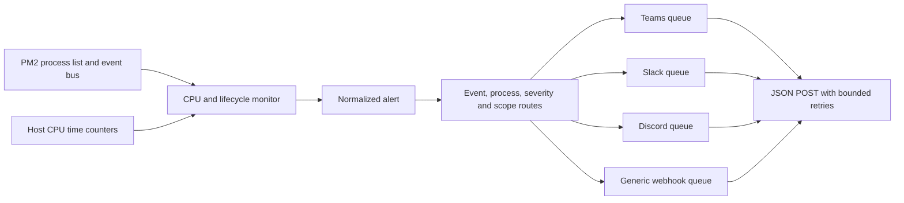

# Architecture and delivery guarantees

Explanation for maintainers and operators deciding where the notifier fits in their monitoring system.

**Owner:** Project maintainers · **Last reviewed:** 2026-10-15 · **Review by:** 2027-01-15 or an architecture change.

## Alert flow

The notifier runs as a PM2 module under the same user and `PM2_HOME` as the applications it observes. It polls process snapshots and host CPU counters, and listens to PM2 lifecycle events. Every alert uses a common schema before routing and provider formatting. Monitoring and delivery use separate in-memory state; one slow destination does not block other destination queues.

Production installation uses an npm `.tgz` archive containing `dist/` and the resolved production dependencies. PM2 stores and registers this package under `PM2_HOME/modules`, independently of the source checkout. Local-directory installation is a development path with file watching and does not register the module for daemon startup. PM2 restores registered modules separately from the application list saved by `pm2 save`.

## Configuration and local UI

Managed mode combines a loopback HTTP server, a private settings store, and the existing monitoring runtime. The browser edits channels, workflows, and monitoring options; the server validates them through the same configuration schema used by manual JSON files. Channels map to destinations and workflows map to routes. Webhook credentials are held by the server and never included in settings reads sent back to the browser.

The server binds to `127.0.0.1` and generates a fresh access token on every start. Its logged browser URL carries the token in a fragment; API requests use an authentication header. An SSH tunnel provides remote access without opening a public listener. Keep the startup access link private.

Configuration and credentials are saved together through an atomic replacement of a mode-`600` file. Saving and applying are separate outcomes: a valid saved configuration can remain on disk even if the PM2 runtime cannot start, and the UI reports that failure. Applying stops the previous runtime and starts a new one in the same process, resetting CPU and lifecycle state. A save may therefore produce another startup notification when `notifyOnStart` is enabled. Pending delivery follows the runtime's normal shutdown behavior.

The PM2 module uses managed mode when no manual configuration path is provided. An explicit `configPath` or `NOTIFIER_CONFIG` preserves manual file mode with no module UI. The standalone `ui` CLI runs both the UI and the monitor. It must not be run alongside another notifier for the same daemon, or both will observe and deliver alerts.

## CPU observations

The initial configuration samples every five seconds. High CPU is reported after observations at or above the threshold span the configured 60 seconds. Each process instance has separate state, and host CPU has separate state. Measurement is sampled and approximate: activity between observations is unknown, and a long poll adds delay to alert timing.

A reading below the high threshold resets the pending high interval. After an alert, that incident stays active until readings at or below the lower recovery threshold span the recovery duration. Values between the two thresholds keep an active incident open without sending duplicate high alerts. This separation prevents fluctuations around the high threshold from creating repeated alerts.

An invalid CPU value or a gap greater than twice the poll interval resets duration continuity while retaining an active incident until sustained recovery. A failed PM2 poll resets all CPU observation state and logs the failure; a later sustained high interval can therefore produce a fresh alert. Process identity/generation changes reset that process's CPU baseline. Restarting the notifier resets all monitoring state; it does not restore an earlier high incident or emit its recovery retrospectively.

Process CPU comes from PM2 and is measured relative to one logical core. Host CPU uses the difference in OS CPU time counters across all logical cores. A process using 100% of one core on an eight-core machine can account for roughly 12.5% host CPU. The host calculation reflects the OS counters visible to this process; it is not a container CPU-quota monitor.

## Lifecycle classification and reasons

The monitor reconciles PM2 event-bus messages with process snapshots. Existing processes form the initial baseline. `notifyOnStart` enables optional started notifications; it is false by default.

Stop, errored, and deleted transitions wait for `settleMs` before notification. If the process returns online or a new generation appears during that interval, the monitor combines the transition into a restart notification. Restart counters, process identity, and uptime changes help detect restarts between polls. Longer stops can produce a stop/error notification followed by a later restart notification. A stopped or removed process ends its prior CPU observation state.

Events and snapshots provide best-effort evidence. A PM2-reported exit code is included when present; otherwise the reason is explicitly unknown. The notifier does not parse application logs, OS logs, or signal history. It cannot reliably identify a deployment, manual restart, uncaught exception, OOM kill, or administrative stop solely from these observations. PM2 `online` also does not establish application readiness.

## Delivery guarantees

Every destination owns an independent serial FIFO queue. `maxQueueSize` counts all alerts in its active request plus pending alerts. If full, the newest arrival is dropped and an error is logged. Routing deduplicates a destination ID within one alert; it does not deduplicate two different IDs pointing at the same URL.

Each attempt uses a JSON POST with an explicit timeout and no redirect following. Successful 2xx responses mean the endpoint accepted the request. Network failures, timeouts, HTTP 429, and HTTP 500–599 are retried up to `maxAttempts`, including the first attempt. Other HTTP responses fail without retry.

The retry delay uses exponential backoff with 50–100% jitter, bounded by `maxDelayMs`. A valid `Retry-After` value in seconds or as an HTTP date is honored within that cap and never shortens the jittered delay. A provider requesting a longer wait than the configured cap can therefore receive a retry earlier than requested; choose a suitable cap or use a relay when strict long provider backoff is required.

Queues and monitoring state are in memory. Process crashes, host failures, restarts, queue overflow, or exhausted retries can lose alerts. A timeout can occur after the receiver has accepted a request, so retries may duplicate messages. This is best-effort delivery; it offers neither exactly-once nor durable at-least-once guarantees. Generic receivers can use the alert `id` to deduplicate requests.

On graceful shutdown, the runtime stops observing and attempts to drain queues for up to ten seconds. Exceeding that limit fails shutdown and can lose queued alerts. Normal PM2 module configuration allows twelve seconds before forced termination. A delivery failure is logged and draining reports failure; exhausted notifications are not automatically stored or replayed. Use a durable external relay if losing a notification is unacceptable.

## Payload boundaries

Teams messages group events over a configurable 30-second window and use a compact Adaptive Card 1.5 envelope, with up to 20 event rows per card and each row capped at 350 characters. The header shows the first event's date in full English form (for example, `10 January 2026`), and the timeline uses one table with shared column widths and left/top cell alignment for time, process, and update. Each row shows its own time including seconds, with UTC labeled once above the time column. Process names wrap independently of timestamps, PM2 IDs distinguish instances, event labels use severity colors, and CPU/exit details appear below each label. The clickable header logo links to `https://github.com/thechandanbhagat/pm2-notifier`. The original logo is included at `assets/pm2-notifier-logo.png`. A 64-pixel transparent PNG rendition at `assets/pm2-notifier-logo-card.png` is embedded as a base64 data URI in `src/branding.ts`, so card images need no hosting or GitHub repository. There is no bottom GitHub button. The Workflows attribution and Get template link are added by Teams outside the notifier payload; see the [workflow footer instructions](operations.md#workflow-template-attribution) for the reported workaround. Larger batches split into multiple cards, and the formatter also splits earlier when needed to keep each UTF-8 payload within 28,000 bytes; flush and graceful shutdown bypass the grouping delay. Slack text is capped at 2900 characters, disables markdown/mention parsing and link unfurls, and escapes potentially active mention content. Discord uses embeds, disables allowed mentions, and caps title/description text at 200/4000 characters. These limits keep normal alerts within provider payload boundaries. Generic JSON payloads are not truncated.

Webhook URLs and static header values come from the private managed settings file in UI mode, or environment variables with an optional protected env file in manual mode. Delivery logs avoid webhook credentials, raw application logs, and provider response bodies. Only configured destinations receive alerts. Routing and templates allow custom endpoint schemas; authentication protocols requiring fresh signatures or token refresh belong in an adapter service.

## Availability boundary

This module observes one PM2 daemon and the local OS. A daemon or host outage can prevent observation and delivery, and a lost event-bus connection can miss short transitions between polls. Polling continues after event-bus errors, with errors recorded locally. An independent external monitor is required to detect server downtime and failure of the notifier itself.
